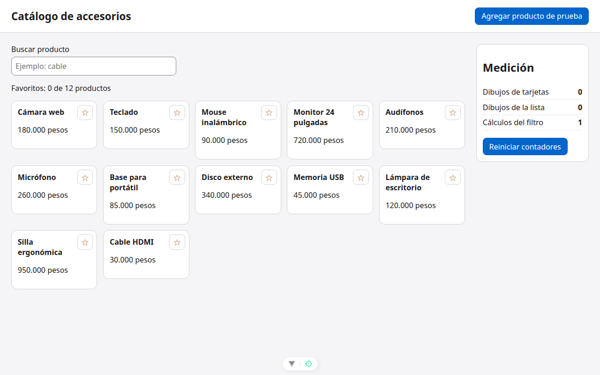
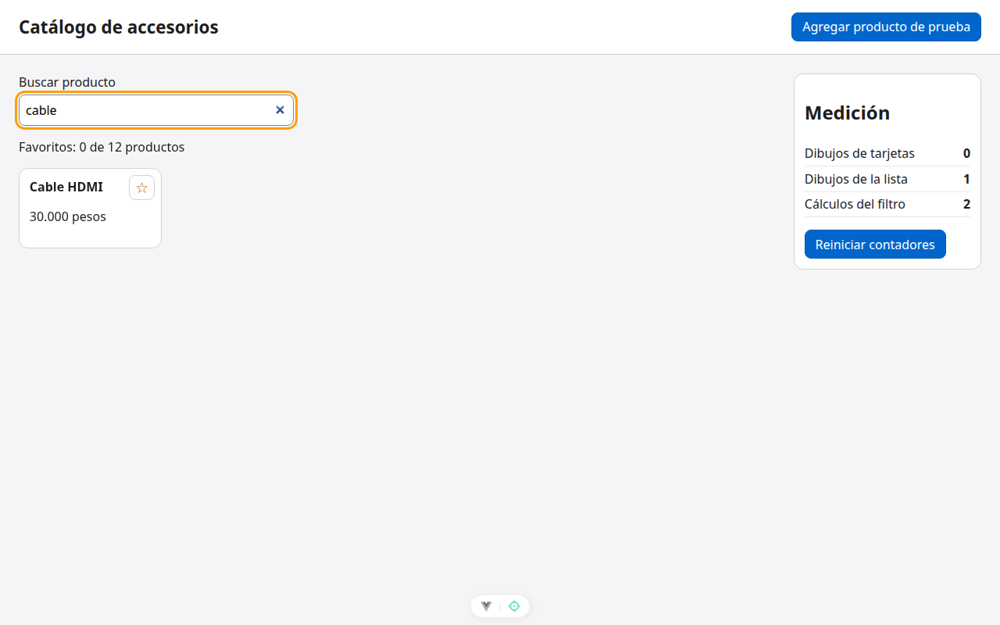

# Paso 1. Construir el catálogo de partida

<!-- lang: es-CO -->

Práctica 1.4, catálogo de 12 productos con panel de medición de dibujos.

## Qué cambió en este paso

- Nuevos: `src/style.css`, `src/datos.js`, `src/medicion.js`, `src/components/ListaProductos.vue`, `src/components/TarjetaProducto.vue`.
- Reemplazados: `src/main.js` (carga estilos y activa `app.config.performance`) y `src/App.vue` (datos del catálogo y `provide`).

## Concepto

Estado vigilado con `ref`, datos compartidos con `provide`/`inject`, listas con `v-for` y `:key`, `v-model` en el buscador y el hook `onUpdated` para contar redibujos. El catálogo funciona pero trabaja de más: el filtro es una función que se llama en cada dibujo y cada tarjeta lee la lista completa de favoritos.

## Cómo ejecutar

```bash
npm install              # instala las dependencias (una vez por carpeta)
npx vite --port 5171     # como en la guía; también sirve npm run dev (puerto 5173)
```

Abre `http://localhost:5171/` en Chrome.

## Qué debes ver

Según la guía: el catálogo con 12 tarjetas y, a la derecha, el panel **Medición** con Dibujos de tarjetas **0**, Dibujos de la lista **0** y Cálculos del filtro **1**. Escribe "cable" en el buscador: queda solo "Cable HDMI".

## Captura



*Al abrir: 12 tarjetas y contadores 0, 0 y 1.*



*Con "cable" en el buscador: solo "Cable HDMI".*

Capturas tomadas en Chrome sin interfaz con el servidor en el puerto 5371, por eso no se ve la barra de direcciones.
