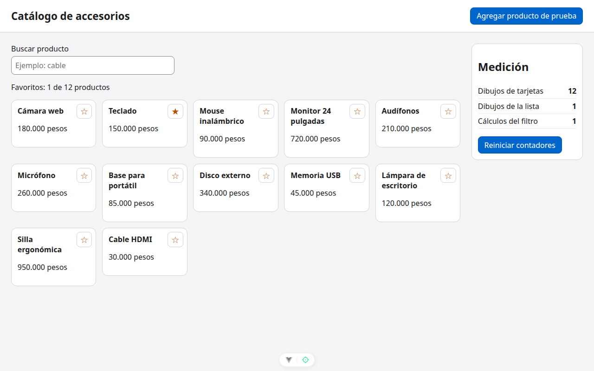

# Paso 2. Medir el problema

<!-- lang: es-CO -->

Práctica 1.4, catálogo de 12 productos con panel de medición de dibujos.

## Qué cambió en este paso

- Ningún archivo cambia: el código es igual al del paso 1. Este paso es de medición.

## Concepto

Antes de optimizar hay que medir. Cada tarjeta llamó a `esFavorito()`, que lee la lista completa de favoritos: Vue anotó que las 12 la leyeron y, cuando cambia, las redibuja a todas.

## Cómo ejecutar

```bash
npm install              # instala las dependencias (una vez por carpeta)
npx vite --port 5171     # como en la guía; también sirve npm run dev (puerto 5173)
```

Abre `http://localhost:5171/` en Chrome.

## Qué debes ver

Según la guía: tras **Reiniciar contadores** y marcar la estrella de **Teclado**: Dibujos de tarjetas **12**, Dibujos de la lista **1**, Cálculos del filtro **1**.

## Captura



*Teclado marcado (★) y contadores 12, 1 y 1: la columna "Antes".*

Capturas tomadas en Chrome sin interfaz con el servidor en el puerto 5371, por eso no se ve la barra de direcciones.
