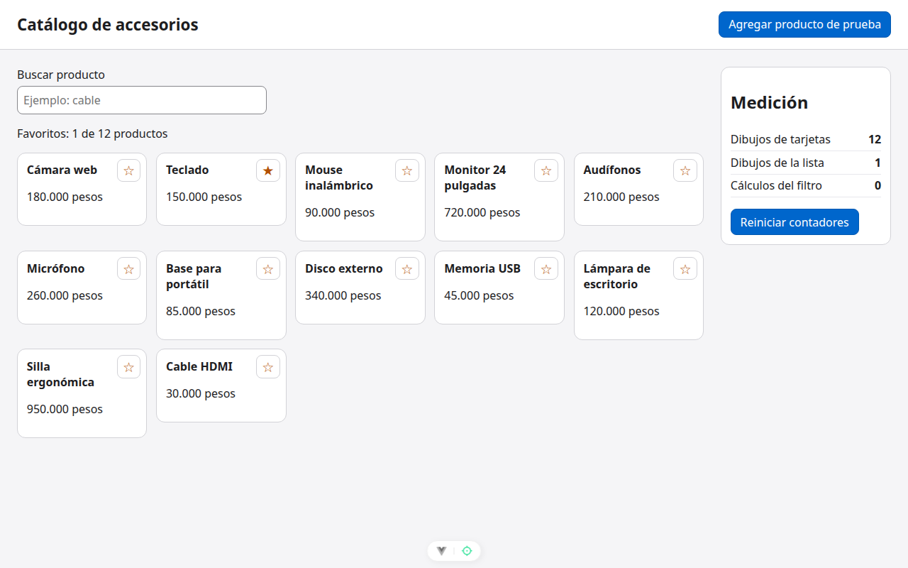

# Paso 3. Guardar el filtro con computed

<!-- lang: es-CO -->

Práctica 1.4, catálogo de 12 productos con panel de medición de dibujos.

## Qué cambió en este paso

- Cambiado: `src/components/ListaProductos.vue` (`computed` en el `import`, `function filtrar()` pasa a `const filtrados = computed(...)` y la plantilla usa `filtrados` sin paréntesis).

## Concepto

Un `computed` guarda su resultado y solo lo recalcula cuando cambia un dato vigilado que leyó (`consulta` o `productos`). Marcar un favorito no cambia ninguno de los dos, así que el filtro no se vuelve a calcular.

## Cómo ejecutar

```bash
npm install              # instala las dependencias (una vez por carpeta)
npx vite --port 5171     # como en la guía; también sirve npm run dev (puerto 5173)
```

Abre `http://localhost:5171/` en Chrome.

## Qué debes ver

Según la guía: cálculos del filtro **0**. Las tarjetas siguen en **12**: eso se arregla en el paso 4.

## Captura



*Tras reiniciar y marcar Teclado: contadores 12, 1 y 0.*

Capturas tomadas en Chrome sin interfaz con el servidor en el puerto 5371, por eso no se ve la barra de direcciones.
