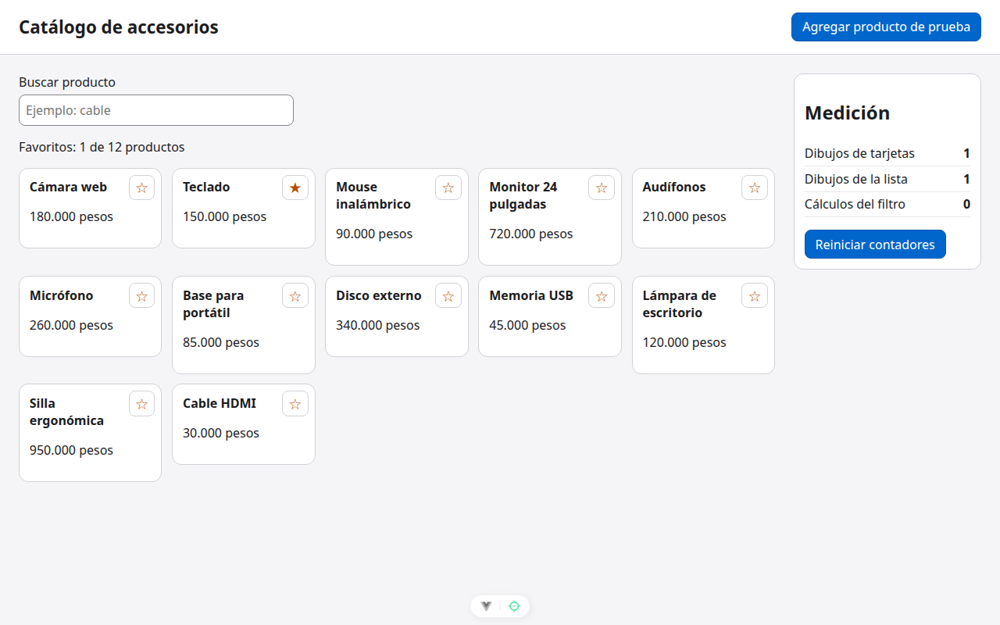

# Paso 4. Darle a cada tarjeta solo lo que necesita

<!-- lang: es-CO -->

Práctica 1.4, catálogo de 12 productos con panel de medición de dibujos.

## Qué cambió en este paso

- Cambiado: `src/components/ListaProductos.vue` (toma `alternarFavorito` y pasa `:favorito` y `@alternar` a cada tarjeta).
- Cambiado: `src/components/TarjetaProducto.vue` (sin `inject`: recibe `favorito` por prop y emite `alternar` con `defineEmits`).

## Concepto

Los datos bajan por props y los avisos suben por eventos. Vue compara las props de cada tarjeta: si su `favorito` (un `true` o `false`) no cambió, no la redibuja. Al marcar una estrella solo cambia el booleano de una tarjeta.

## Cómo ejecutar

```bash
npm install              # instala las dependencias (una vez por carpeta)
npx vite --port 5171     # como en la guía; también sirve npm run dev (puerto 5173)
```

Abre `http://localhost:5171/` en Chrome.

## Qué debes ver

Según la guía: dibujos de tarjetas **1**.

## Captura



*Tras reiniciar y marcar Teclado: contadores 1, 1 y 0.*

Capturas tomadas en Chrome sin interfaz con el servidor en el puerto 5371, por eso no se ve la barra de direcciones.
