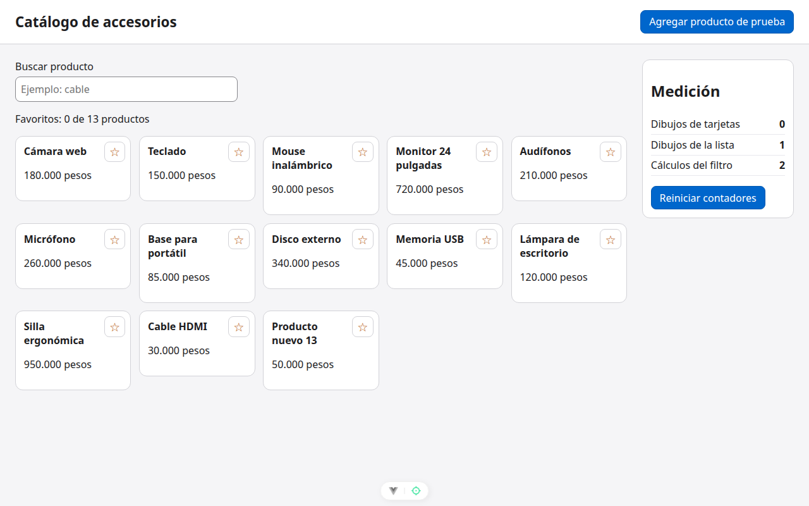

# Paso 5. shallowRef para la lista grande

<!-- lang: es-CO -->

Práctica 1.4, catálogo de 12 productos con panel de medición de dibujos.

## Qué cambió en este paso

- Cambiado: `src/App.vue` (`shallowRef` en el `import`, `const productos = shallowRef(...)` y `agregarProducto` asigna una lista nueva en lugar de `push`).

## Concepto

`shallowRef` vigila solo `.value`: que llegue una lista nueva. No recorre cada producto por dentro, lo que ahorra tiempo y memoria con listas grandes. Por eso un `push` no se ve (se comprobó: con `push` siguen 12 tarjetas) y hay que asignar `[...productos.value, nuevo]`.

## Cómo ejecutar

```bash
npm install              # instala las dependencias (una vez por carpeta)
npx vite --port 5171     # como en la guía; también sirve npm run dev (puerto 5173)
```

Abre `http://localhost:5171/` en Chrome.

## Qué debes ver

Según la guía: la tarjeta "Producto nuevo 13" al final y el resumen "Favoritos: 0 de 13 productos".

## Captura



*Tras pulsar **Agregar producto de prueba**: "Producto nuevo 13" al final y "Favoritos: 0 de 13 productos".*

Capturas tomadas en Chrome sin interfaz con el servidor en el puerto 5371, por eso no se ve la barra de direcciones.
