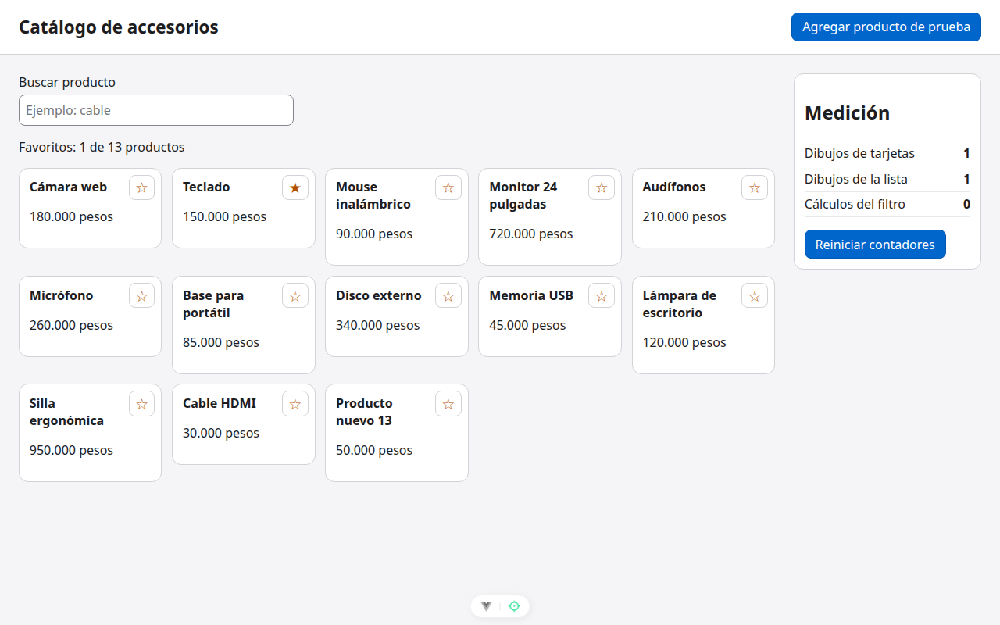

# Paso 6. Cerrar la medición

<!-- lang: es-CO -->

Práctica 1.4, catálogo de 12 productos con panel de medición de dibujos.

## Qué cambió en este paso

- Ningún archivo cambia: es el proyecto terminado, igual en código a `ejercicio-resuelto/` (solo cambian los comentarios).

## Concepto

Se repite la medición del paso 2 para llenar la columna "Después". La lista se sigue dibujando una vez porque muestra "Favoritos: N de 13 productos", que sí cambió: ese dibujo es necesario.

## Cómo ejecutar

```bash
npm install              # instala las dependencias (una vez por carpeta)
npx vite --port 5171     # como en la guía; también sirve npm run dev (puerto 5173)
```

Abre `http://localhost:5171/` en Chrome.

## Qué debes ver

Según la guía: columna "Después": Dibujos de tarjetas **1**, Dibujos de la lista **1**, Cálculos del filtro **0** (antes: 12, 1 y 1).

## Captura



*Con 13 productos, tras reiniciar y marcar Teclado: contadores 1, 1 y 0.*

Capturas tomadas en Chrome sin interfaz con el servidor en el puerto 5371, por eso no se ve la barra de direcciones.
