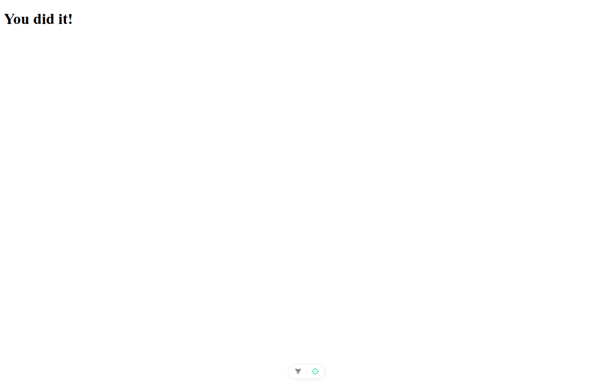

# Paso 0. Preparación

<!-- lang: es-CO -->

Proyecto recién creado con `npx --yes create-vue@3.16.4 lab02-composables --default --bare`.

## Qué cambió en este paso

- Todos los archivos vienen de create-vue y no se cambia ninguno. Solo se agregaron comentarios a `src/main.js` y `src/App.vue`.

## Concepto

`main.js` crea la aplicación con `createApp(App)` y la monta en `<div id="app">` de `index.html`. `App.vue` es un componente de un solo archivo (SFC) que junta script, plantilla y estilos. `vite.config.js` trae las Vue DevTools.

## Cómo ejecutar

```bash
npm install              # instala las dependencias (una vez por carpeta)
npx vite --port 5172     # como en la guía; también sirve npm run dev (puerto 5173)
```

Abre `http://localhost:5172/` en Chrome.

## Qué debes ver

Según la guía: en la terminal, `Local: http://localhost:5172/`. Ábrelo en Chrome: aparece el título "You did it!" y, abajo, el botón flotante de las Vue DevTools.

## Captura



*Título "You did it!" y, abajo al centro, el botón flotante de las Vue DevTools.*

Capturas tomadas en Chrome sin interfaz con el servidor en el puerto 5372, por eso no se ve la barra de direcciones. La franja oscura, cuando aparece, reproduce lo que muestra la consola de `F12`.
