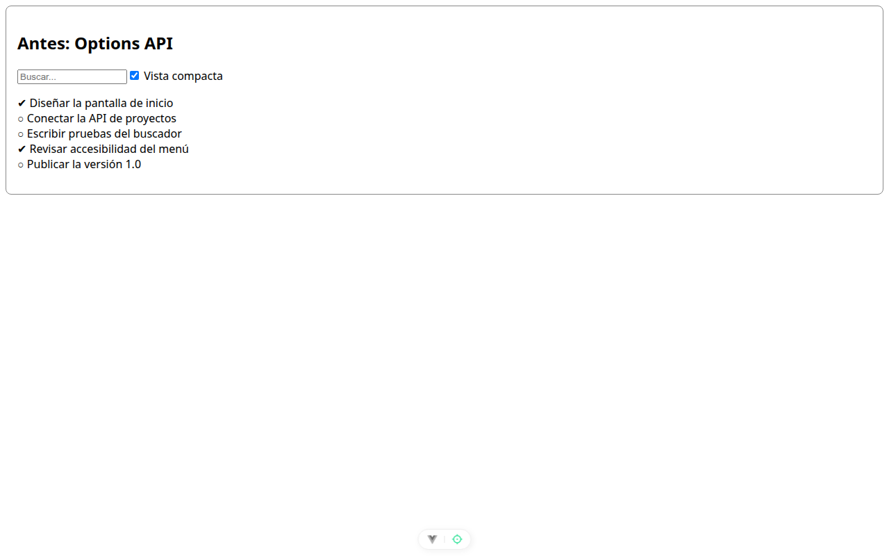

# Paso 1. El punto de partida en Options API

<!-- lang: es-CO -->

Práctica 2.4, ProjectHub: refactorizar de Options API a Composition API con composables.

## Qué cambió en este paso

- Nuevos: `src/datos.js` (carga simulada de 800 ms) y `src/TareasOpciones.vue` (versión clásica).
- Reemplazado: `src/App.vue` (columna con `TareasOpciones` y estilos).

## Concepto

Options API agrupa el código por tipo (`data`, `computed`, `watch`, `mounted`) y no por tarea: la preferencia vive en `data` y `watch`, y la carga en `data` y `mounted`. Para entender una tarea hay que leer el archivo entero.

## Cómo ejecutar

```bash
npm install              # instala las dependencias (una vez por carpeta)
npx vite --port 5172     # como en la guía; también sirve npm run dev (puerto 5173)
```

Abre `http://localhost:5172/` en Chrome.

## Qué debes ver

Según la guía: "Cargando..." durante casi un segundo y luego 5 tareas. Tras recargar, la casilla sigue marcada y la lista sigue apretada.

## Captura



*Tras marcar **Vista compacta** y recargar: la casilla sigue marcada y la lista apretada. Al abrir se comprobó también "Cargando..." antes de las 5 tareas.*

Capturas tomadas en Chrome sin interfaz con el servidor en el puerto 5372, por eso no se ve la barra de direcciones. La franja oscura, cuando aparece, reproduce lo que muestra la consola de `F12`.
