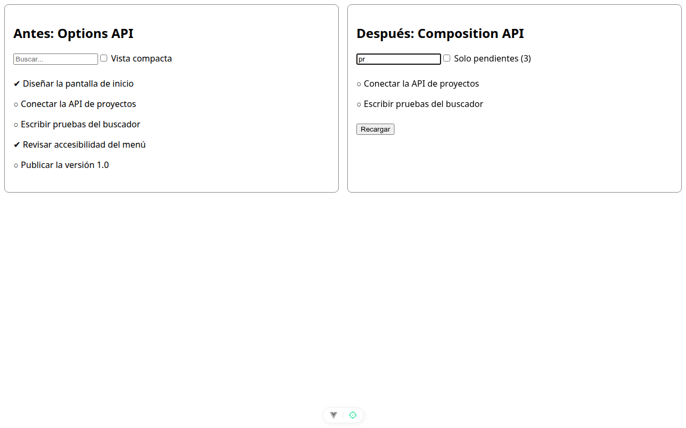
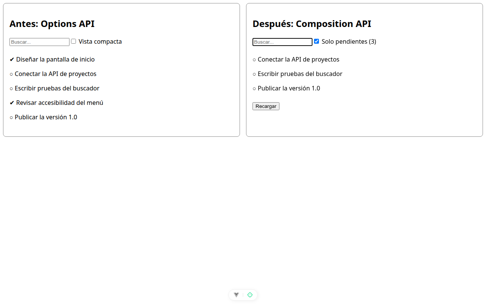
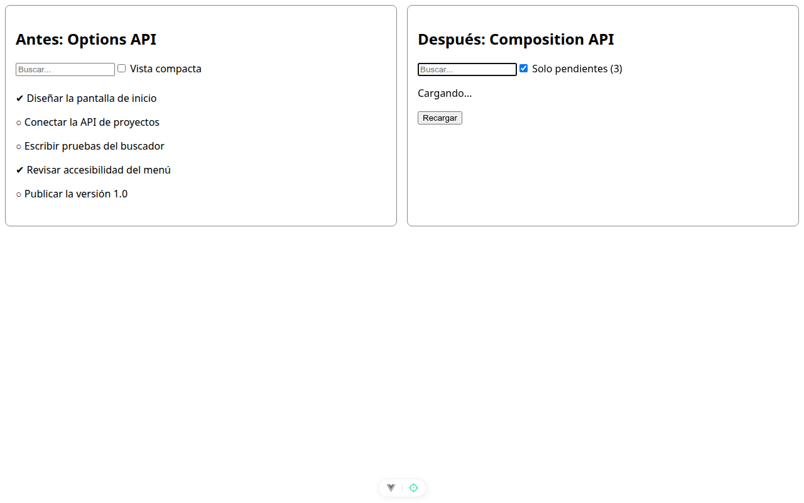

# Paso 2. Primeros composables: carga y buscador

<!-- lang: es-CO -->

Práctica 2.4, ProjectHub: refactorizar de Options API a Composition API con composables.

## Qué cambió en este paso

- Nuevos: `src/composables/useAsyncState.js`, `src/composables/useProjectFilters.js` y `src/ProjectHubView.vue`.
- Cambiado: `src/App.vue` (importa y muestra `ProjectHubView` junto a `TareasOpciones`).

## Concepto

Un composable es una función `useAlgo()` que junta el estado, los cálculos y los efectos de una sola tarea y crea su propio estado en cada llamada. La lista de tareas (un `ref`) pasa de `useAsyncState` a `useProjectFilters`: así se componen.

## Cómo ejecutar

```bash
npm install              # instala las dependencias (una vez por carpeta)
npx vite --port 5172     # como en la guía; también sirve npm run dev (puerto 5173)
```

Abre `http://localhost:5172/` en Chrome.

## Qué debes ver

Según la guía: dos columnas. En **Después** quedan "Conectar la API de proyectos" y "Escribir pruebas del buscador", ordenadas de la A a la Z; **Antes** no cambia, porque cada componente tiene su propio estado. **Solo pendientes (3)** oculta las hechas, y **Recargar** muestra "Cargando..." otra vez.

## Captura



*"pr" en el buscador de **Después**: quedan "Conectar la API de proyectos" y "Escribir pruebas del buscador"; **Antes** sigue con sus 5 tareas.*



***Solo pendientes (3)** marcado: quedan las 3 tareas sin hacer.*



*Justo después de pulsar **Recargar**: "Cargando..." en **Después**.*

![Opcional de la guía, rama de error: con `Promise.reject(new Error('sin red'))` la columna **Después** muestra "No se pudieron cargar las tareas". El código entregado conserva `useAsyncState(pedirTareas, [])`.](captura-error.png)

*Opcional de la guía, rama de error: con `Promise.reject(new Error('sin red'))` la columna **Después** muestra "No se pudieron cargar las tareas". El código entregado conserva `useAsyncState(pedirTareas, [])`.*

Capturas tomadas en Chrome sin interfaz con el servidor en el puerto 5372, por eso no se ve la barra de direcciones. La franja oscura, cuando aparece, reproduce lo que muestra la consola de `F12`.
