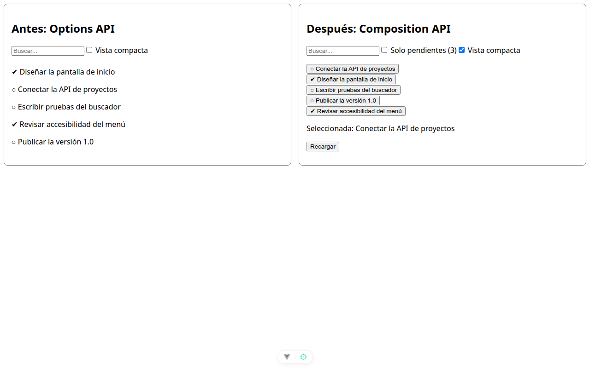

# Paso 3. Composables de selección y de preferencia

<!-- lang: es-CO -->

Práctica 2.4, ProjectHub: refactorizar de Options API a Composition API con composables.

## Qué cambió en este paso

- Nuevos: `src/composables/useTaskSelection.js` y `src/composables/useLocalPreferences.js`.
- Cambiado: `src/ProjectHubView.vue` (dos `import`, dos llamadas nuevas y la plantilla con botones por tarea, casilla **Vista compacta** y línea "Seleccionada").

## Concepto

`useTaskSelection` guarda solo el id y calcula la tarea con `computed`; la única puerta para cambiarla es `seleccionar()`. `useLocalPreferences` usa `watch`, un efecto que guarda cada cambio en `localStorage` para que sobreviva a `F5`.

## Cómo ejecutar

```bash
npm install              # instala las dependencias (una vez por carpeta)
npx vite --port 5172     # como en la guía; también sirve npm run dev (puerto 5173)
```

Abre `http://localhost:5172/` en Chrome.

## Qué debes ver

Según la guía: la vista compacta se conserva; la selección vuelve a "ninguna", porque solo la preferencia se guardó en el navegador. Cada columna usa su propia clave (`compacta` y `vista-compacta`), así que cada una recuerda lo suyo.

## Captura



*Antes de recargar: "Seleccionada: Conectar la API de proyectos" y **Vista compacta** marcada en **Después**.*


*Después de `F5`: **Vista compacta** sigue marcada (en `localStorage` quedó `vista-compacta: "true"`) y "Seleccionada: ninguna".*

Capturas tomadas en Chrome sin interfaz con el servidor en el puerto 5372, por eso no se ve la barra de direcciones. La franja oscura, cuando aparece, reproduce lo que muestra la consola de `F12`.
