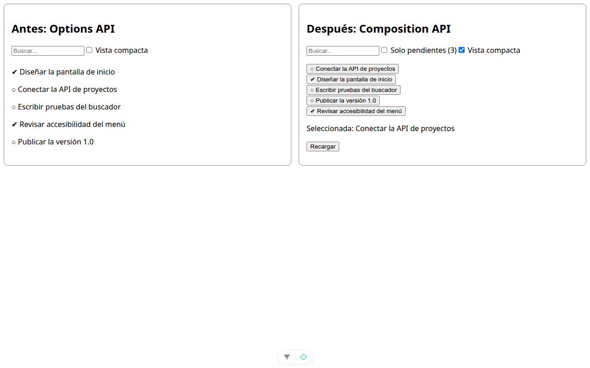

# Paso 4. Contexto con provide y un renderless

<!-- lang: es-CO -->

Práctica 2.4, ProjectHub: refactorizar de Options API a Composition API con composables.

## Qué cambió en este paso

- Nuevos: `src/keys.js` (clave `Symbol` y `useProjectHubContext`) y `src/TaskCollectionProvider.vue` (renderless).
- Reemplazado: `src/ProjectHubView.vue` (ofrece el contexto con `provide` y `readonly`, y la lista llega por el slot de `TaskCollectionProvider`).

## Concepto

`provide` con una clave `Symbol` ofrece datos a los componentes de abajo sin pasarlos por props; `readonly` evita que los cambien. El renderless no dibuja nada propio: entrega la lista y sus acciones por un slot con datos, y quien lo usa decide cómo se ven.

## Cómo ejecutar

```bash
npm install              # instala las dependencias (una vez por carpeta)
npx vite --port 5172     # como en la guía; también sirve npm run dev (puerto 5173)
```

Abre `http://localhost:5172/` en Chrome.

## Qué debes ver

Según la guía: la columna **Después** funciona igual que en el paso 3. Ese es el punto de una refactorización: por fuera nada cambia.

## Captura



*Antes de recargar: "Seleccionada: Conectar la API de proyectos" y **Vista compacta** marcada, igual que en el paso 3.*


*Después de `F5`: **Vista compacta** se conserva y "Seleccionada: ninguna", igual que en el paso 3.*

Capturas tomadas en Chrome sin interfaz con el servidor en el puerto 5372, por eso no se ve la barra de direcciones. La franja oscura, cuando aparece, reproduce lo que muestra la consola de `F12`.
