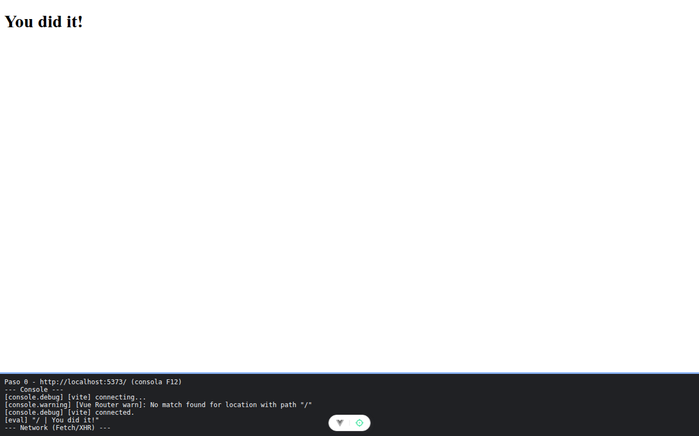

# Paso 0. Preparación

<!-- lang: es-CO -->

Práctica 3.4, ProjectHub con Vue Router. Proyecto recién creado con `npx --yes create-vue@3.16.4 projecthub-router --bare --router`.

## Qué cambió en este paso

- Todos los archivos vienen de create-vue. Solo se agregaron comentarios a `src/main.js`, `src/App.vue` y `src/router/index.js`.

## Concepto

`--router` instala Vue Router y lo conecta en `src/main.js` con `app.use(router)`. La tabla de rutas empieza vacía (`routes: []`), así que ninguna dirección coincide todavía.

## Cómo ejecutar

```bash
npm install
npm run dev
```

Abre la dirección que muestra la terminal (normalmente `http://localhost:5173/`).

## Qué debes ver

Según la guía: la terminal muestra `Local: http://localhost:5173/`. Ábrelo en Chrome: aparece el título "You did it!". En la consola de Chrome (`F12`) verás el aviso `[Vue Router warn]: No match found for location with path "/"`: es normal, la tabla de rutas todavía está vacía.

## Captura



Título "You did it!" y, en el panel de consola, el aviso `No match found for location with path "/"`. La franja oscura de abajo reproduce lo que muestran la consola y la red de `F12`; se tomó con el servidor en otro puerto (5373 o 4373), por eso la dirección no dice 5173.
