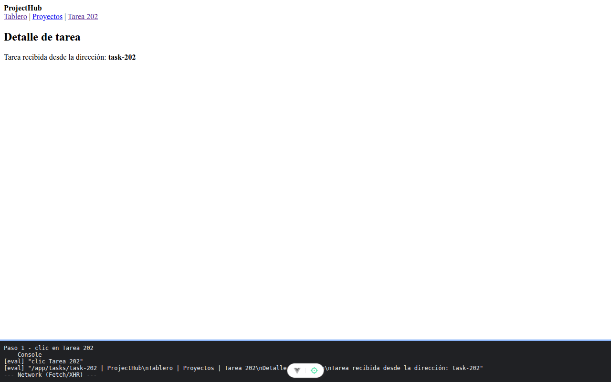

# Paso 1. El mapa de rutas anidadas

<!-- lang: es-CO -->

Práctica 3.4, ProjectHub con Vue Router. Tabla de rutas con una ruta padre `/app` y sus hijas.

## Qué cambió en este paso

- Nuevos: `src/sesion.js`, `src/views/ProjectHubLayout.vue`, `src/views/DashboardView.vue`, `src/views/ProjectsView.vue`, `src/views/TaskDetailView.vue`, `src/views/NotFoundView.vue`.
- Reemplazados: `src/router/index.js` (tabla de rutas) y `src/App.vue` (solo `<RouterView />`).

## Concepto

Rutas anidadas: el padre dibuja el menú y un `RouterView` propio donde aparece la hija. Navegación por `name`, parámetro dinámico `:taskId` entregado como prop con `props: true`, redirección de `/` y ruta comodín `/:pathMatch(.*)*` al final.

## Cómo ejecutar

```bash
npm install
npm run dev
```

Abre la dirección que muestra la terminal (normalmente `http://localhost:5173/`).

## Qué debes ver

Según la guía: la dirección cambia a `/app/dashboard` y se ven el menú y "Tablero". Pulsa **Tarea 202**: la dirección es `/app/tasks/task-202` y la vista muestra `task-202`. Escribe en la barra `/app/tasks/abc`: muestra `abc`. Escribe `/no-existe`: "Página no encontrada".

## Captura



Después de pulsar **Tarea 202**: menú y "Tarea recibida desde la dirección: task-202". Comprobado también `/app/tasks/abc` (muestra `abc`) y `/no-existe` ("Página no encontrada"). La franja oscura de abajo reproduce lo que muestran la consola y la red de `F12`; se tomó con el servidor en otro puerto (5373 o 4373), por eso la dirección no dice 5173.
