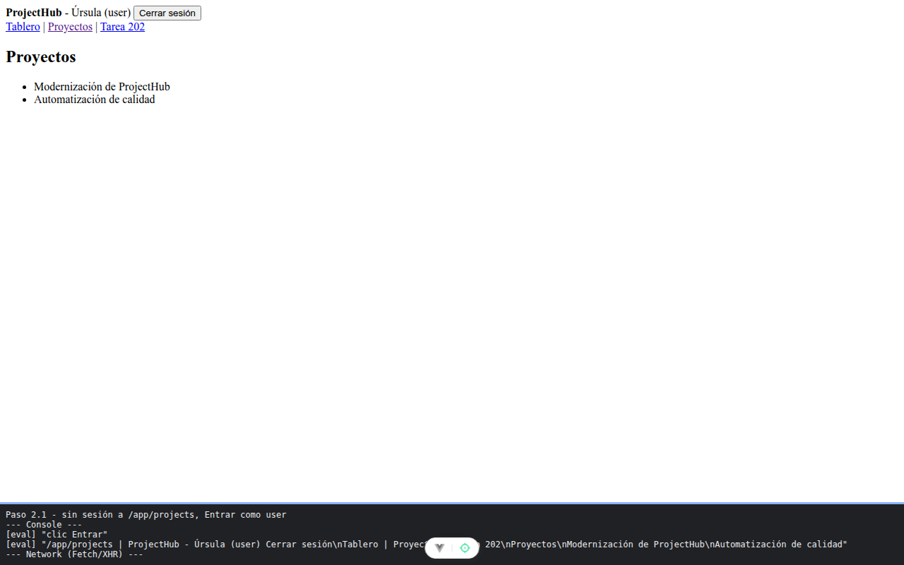

# Paso 2. Sesión, meta y guardia

<!-- lang: es-CO -->

Práctica 3.4, ProjectHub con Vue Router. Rutas que declaran en `meta` lo que exigen y una guardia global que lo aplica.

## Qué cambió en este paso

- Nuevos: `src/views/LoginView.vue`, `src/views/ForbiddenView.vue`, `src/views/AdminView.vue`.
- Cambiado: `src/router/index.js` (3 importaciones, rutas `/login`, `/forbidden` y `/admin`, `meta` en `/app` y `router.beforeEach`).

## Concepto

`meta` guarda requisitos por ruta (`requiresAuth`, `roles`) y los hijos los heredan. `beforeEach` corre antes de cada navegación: si devuelve una ruta, redirige; si no devuelve nada, deja pasar. `?redirect=` recuerda a dónde iba la persona.

## Cómo ejecutar

```bash
npm install
npm run dev
```

Abre la dirección que muestra la terminal (normalmente `http://localhost:5173/`).

## Qué debes ver

Según la guía: `/app/projects` sin sesión te lleva a `/login?redirect=/app/projects`. Pulsa **Entrar** con `user@projecthub.dev`: vuelves a `/app/projects` y el encabezado dice "Úrsula (user)", sin enlace de Administración. Luego `/admin` como user termina en `/forbidden`; como admin ves "Administración"; un correo que no existe muestra "Ese correo no está registrado."

## Captura



Tras abrir `/app/projects` sin sesión y entrar como user: "Úrsula (user)" en `/app/projects`, sin Administración. Comprobados también `/forbidden`, `/admin` como admin y el error de correo. La franja oscura de abajo reproduce lo que muestran la consola y la red de `F12`; se tomó con el servidor en otro puerto (5373 o 4373), por eso la dirección no dice 5173.
