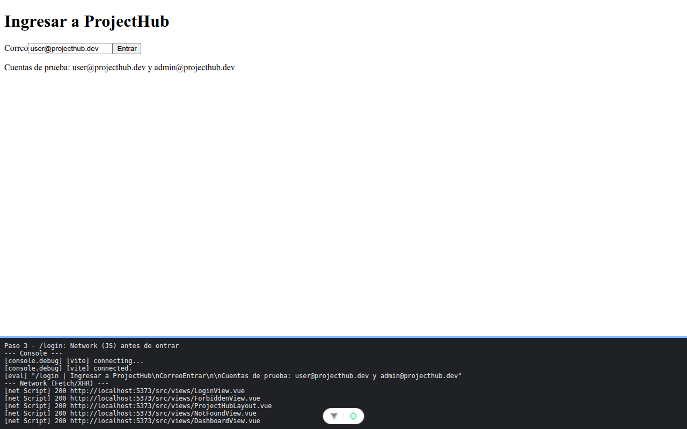

# Paso 3. Carga perezosa y precarga

<!-- lang: es-CO -->

Práctica 3.4, ProjectHub con Vue Router. Las vistas protegidas pasan a `() => import()` y el tablero se precarga desde el ingreso.

## Qué cambió en este paso

- Cambiado: `src/router/index.js` (4 importaciones estáticas pasan a `() => import()` y se agrega `router.afterEach` para precargar).

## Concepto

Carga perezosa: Vite parte cada vista importada con `() => import()` en un archivo `.js` aparte (fragmento) que se descarga al visitar la ruta. Precarga: llamar `DashboardView()` en `afterEach` inicia esa descarga antes de que la persona la pida.

## Cómo ejecutar

```bash
npm install
npm run dev
```

Abre la dirección que muestra la terminal (normalmente `http://localhost:5173/`).

## Qué debes ver

Según la guía: con `npm run build`, cinco archivos `.js` (`DashboardView`, `ProjectsView`, `TaskDetailView`, `AdminView` e `index`). En `/login`, pestaña **Network**, filtro **JS**: `DashboardView.vue` ya aparece sin haber entrado; `ProjectsView.vue` aparece solo al pulsar **Proyectos**.

## Captura



`/login` con el panel de red: `DashboardView.vue` ya descargado (precarga) y sin `ProjectsView.vue`. El build dio los 5 archivos `.js` de la guía; al pulsar Proyectos se descargó `ProjectsView.vue`. La franja oscura de abajo reproduce lo que muestran la consola y la red de `F12`; se tomó con el servidor en otro puerto (5373 o 4373), por eso la dirección no dice 5173.
