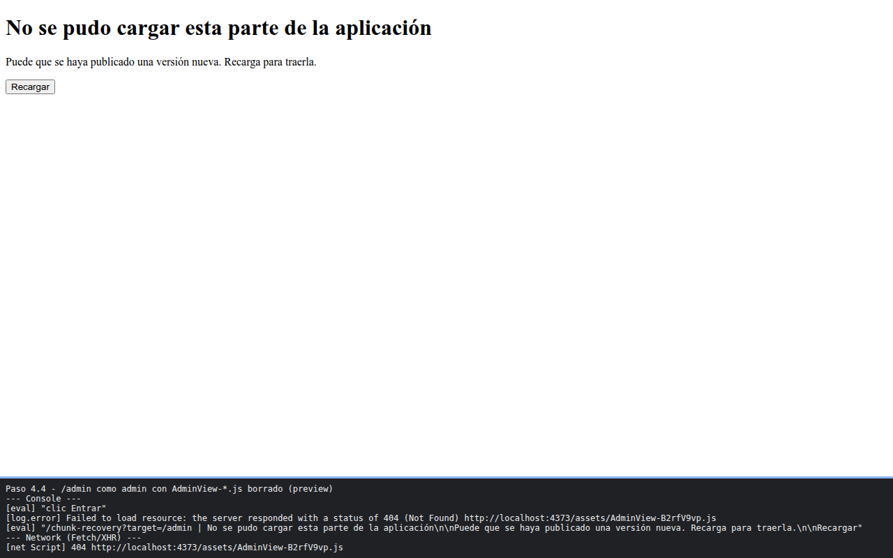

# Paso 4. Errores de navegación y fragmento perdido

<!-- lang: es-CO -->

Práctica 3.4, ProjectHub con Vue Router. Pantalla de rescate cuando falla la descarga de una vista y aviso de navegaciones no completadas.

## Qué cambió en este paso

- Nuevo: `src/views/ChunkRecoveryView.vue`.
- Cambiado: `src/router/index.js` (importación, ruta `/chunk-recovery`, segundo `afterEach` con `failure` y `router.onError`).

## Concepto

`afterEach(to, from, failure)` informa navegaciones que no se completaron (por ejemplo, redundantes). `router.onError` atrapa la falla de un `import()` cuando el fragmento ya no existe en el servidor y lleva a la pantalla de rescate.

## Cómo ejecutar

```bash
npm install
npm run dev
```

Abre la dirección que muestra la terminal (normalmente `http://localhost:5173/`).

## Qué debes ver

Según la guía: Pulsa **Proyectos** dos veces: `[ProjectHub] Navegación no completada: Avoided redundant navigation...`. Con `npm run build`, `rm dist/assets/AdminView-*.js` y `npm run preview`, abre `http://localhost:4173/admin` y entra con `admin@projecthub.dev`: terminas en `/chunk-recovery?target=/admin` con "No se pudo cargar esta parte de la aplicación" y un 404 para `AdminView-<código>.js`.

## Captura



`captura.png`: `/chunk-recovery?target=/admin` con el 404 de `AdminView-*.js` en el panel. `captura-navegacion-redundante.png`: el aviso `Avoided redundant navigation` al pulsar Proyectos dos veces. La franja oscura de abajo reproduce lo que muestran la consola y la red de `F12`; se tomó con el servidor en otro puerto (5373 o 4373), por eso la dirección no dice 5173.
