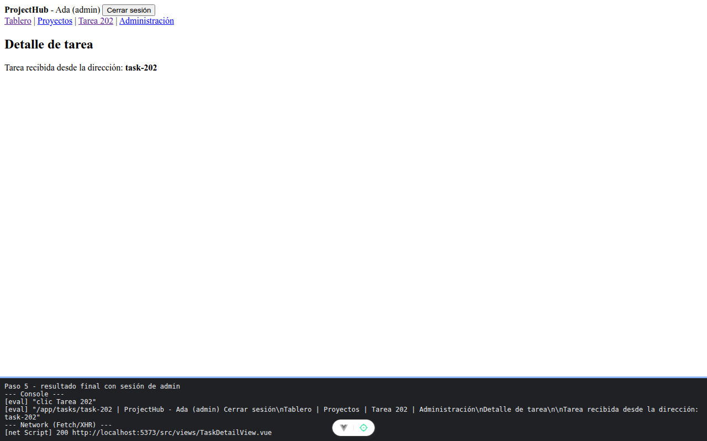

# Paso 5. Comprueba el resultado

<!-- lang: es-CO -->

Práctica 3.4, ProjectHub con Vue Router. Proyecto terminado, igual en código a `ejercicio-resuelto/` (más comentarios). No hay código nuevo en este paso.

## Qué cambió en este paso

- Ninguno respecto al paso 4.

## Concepto

Repaso de todo el capítulo: rutas públicas, protegidas, anidadas, de comodín, carga perezosa y rescate ante fragmento perdido.

| Resultado | Lo viste en |
|---|---|
| Sin sesión, `/app/...` va a `/login` y regresa al entrar | Paso 2, punto 1 |
| En `/admin`, el rol `user` ve `/forbidden`; `admin` entra | Paso 2, puntos 2 y 3 |
| Las vistas protegidas se descargan al visitarlas | Paso 3 |
| Ruta inválida: `NotFoundView`. Fragmento perdido: `ChunkRecoveryView` | Pasos 1 y 4 |

## Cómo ejecutar

```bash
npm install
npm run dev
```

Abre la dirección que muestra la terminal (normalmente `http://localhost:5173/`).

## Qué debes ver

Según la guía: con sesión de administradora: `ProjectHub - Ada (admin) [Cerrar sesión]`, `Tablero | Proyectos | Tarea 202 | Administración`, `Detalle de tarea`, `Tarea recibida desde la dirección: task-202`.

## Captura



Sesión de Ada (admin) en `/app/tasks/task-202`, con el enlace Administración visible. La franja oscura de abajo reproduce lo que muestran la consola y la red de `F12`; se tomó con el servidor en otro puerto (5373 o 4373), por eso la dirección no dice 5173.
