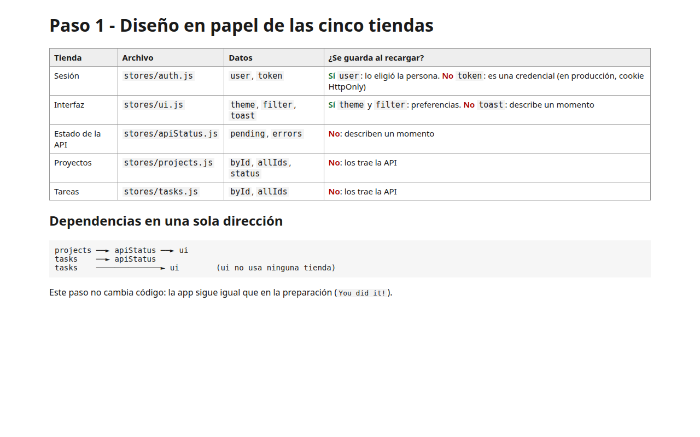

# Capítulo 4 - Paso 1. Diseño en papel

<!-- lang: es-CO -->

Proyecto Vite completo con el código acumulado hasta este paso de la Práctica 4.4 (ProjectHub con Pinia). Los comentarios del código explican cada concepto.

## Qué cambió

Ningún archivo de código: el proyecto es igual al de la preparación. Este paso es el diseño de las tiendas, que está en la captura y abajo.

## Concepto

Antes de escribir una tienda se decide qué dato vive en ella y si debe sobrevivir a la recarga. Se guarda solo lo que eligió la persona (`user`, `theme`, `filter`); nunca credenciales (`token`), ni lo momentáneo (`toast`, `pending`, `errors`), ni lo que trae la API (proyectos y tareas). Las dependencias van en una sola dirección: `projects` y `tasks` usan `apiStatus`; `apiStatus` y `tasks` usan `ui`; `ui` no usa ninguna.

## Cómo ejecutar

```bash
npm install              # instala las dependencias (una vez por carpeta)
npx vite --port 5174     # como en la guía; también sirve npm run dev (puerto 5173)
```

Abre `http://localhost:5174/` en Chrome.

## Qué debes ver

Según la guía: Se guardan `user`, `theme` y `filter`: los eligió la persona. No se guardan `token` (una credencial; en producción va en una cookie HttpOnly), `toast`, `pending` y `errors` (describen un momento) ni proyectos y tareas (los trae la API).



*La tabla del diseño con la respuesta y el sentido de las dependencias.*
