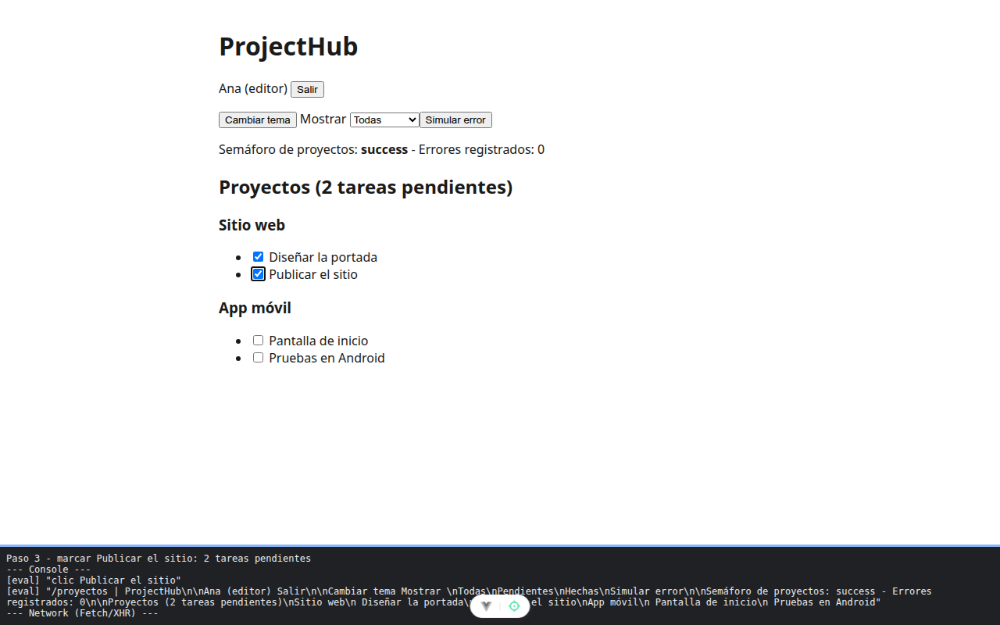

# Capítulo 4 - Paso 3. Tiendas por dominio

<!-- lang: es-CO -->

Proyecto Vite completo con el código acumulado hasta este paso de la Práctica 4.4 (ProjectHub con Pinia). Los comentarios del código explican cada concepto.

## Qué cambió

Nuevos: `src/stores/ui.js`, `src/stores/apiStatus.js`, `src/stores/projects.js`, `src/stores/tasks.js`. Reemplazado: `src/views/ProjectsView.vue`.

## Concepto

Una tienda por dominio. Proyectos y tareas **normalizados**: cada elemento una sola vez en `byId` y el orden en `allIds`, así marcar una tarea cambia la lista y el contador a la vez. Toda llamada a la API pasa por `apiStatus.track`, que cuenta las peticiones y centraliza los errores. Una tienda puede usar otra (`tasks` lee el filtro de `ui`). `forProject` es un getter que devuelve una función.

## Cómo ejecutar

```bash
npm install              # instala las dependencias (una vez por carpeta)
npx vite --port 5174     # como en la guía; también sirve npm run dev (puerto 5173)
```

Abre `http://localhost:5174/proyectos` en Chrome.

## Qué debes ver

Según la guía: `Semáforo de proyectos: success - Errores registrados: 0`, **Proyectos (3 tareas pendientes)** y dos proyectos con sus tareas. [...] el semáforo pasa a `error`, el contador a `Errores registrados: 1` y aparece el aviso `No se pudo cargar proyectos: el servidor respondió 500`.


*Ana dentro: semáforo `success`, 0 errores, 3 tareas pendientes y los dos proyectos; el panel muestra las tiendas que conecta Vue DevTools.*



*Marcar **Publicar el sitio**: el título baja a 2 tareas pendientes.*


***Simular error**: semáforo `error`, `Errores registrados: 1` y el aviso; los proyectos no desaparecen.*
