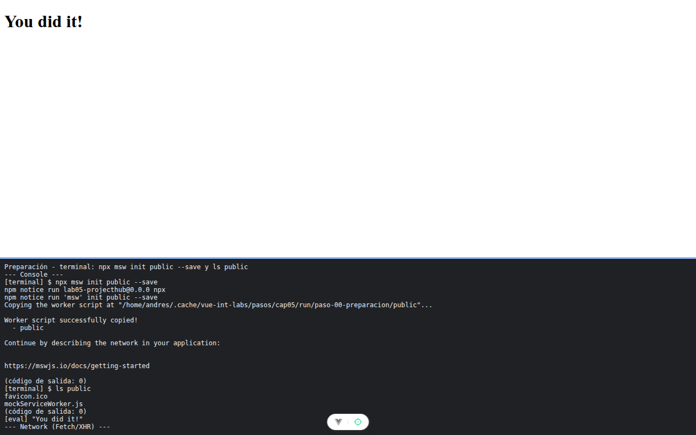

# Paso 0. Preparación

<!-- lang: es-CO -->

Práctica 5.4, ProjectHub con clientes REST (Axios) y GraphQL (Apollo Client) sobre un servidor simulado con MSW.

## Qué cambió en este paso

Proyecto creado con `npx --yes create-vue@3.16.4 lab05-projecthub --bare --pinia`, más las cuatro librerías en versión exacta (`axios@1.20.0`, `@apollo/client@3.13.9`, `graphql@16.11.0`, `msw@2.7.3`), `public/mockServiceWorker.js` (de `npx msw init public --save`) y `.env` con `VITE_API_URL` y `VITE_GRAPHQL_URL`. Se borró `src/stores/counter.js`. Solo se agregaron comentarios a `src/main.js` y `src/App.vue`.

## Concepto

create-vue es la herramienta oficial para crear proyectos de Vue con Vite; `--pinia` deja Pinia instalada y conectada en `main.js`. `npx msw init` copia a `public/` el Service Worker de MSW, el archivo que el navegador registra para interceptar peticiones. Las variables de `.env` con prefijo `VITE_` llegan al navegador por `import.meta.env`, por eso nunca llevan contraseñas.

## Cómo ejecutar

```bash
npm install              # instala las dependencias (una vez por carpeta)
npx vite --port 5175     # como en la guía; también sirve npm run dev (puerto 5173)
```

Abre la dirección que muestra la terminal (`http://localhost:5175/`).

## Qué debes ver

Según la guía: la terminal termina con `Worker script successfully copied!` y en `public/` aparece `mockServiceWorker.js`.

## Captura



Página "You did it!" y, en la franja, la salida real de `npx msw init public --save` (`Worker script successfully copied!`) y de `ls public` con `mockServiceWorker.js`.

La franja oscura de abajo reproduce lo que muestran la consola, la red de `F12` o la terminal; se tomó con el servidor en el puerto 5375, por eso la dirección no dice 5175.
