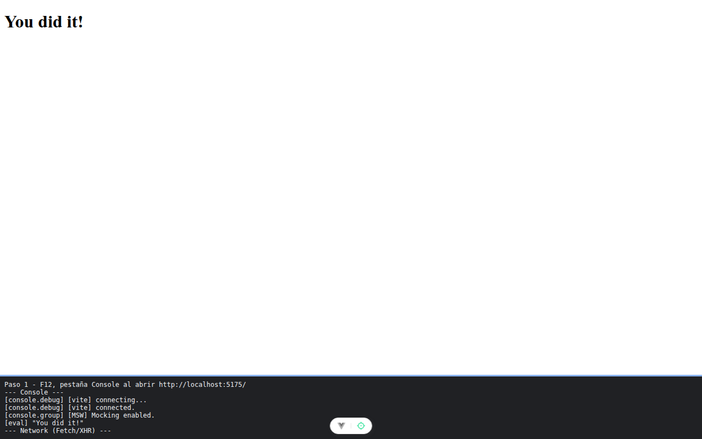

# Paso 1. Encender el servidor simulado

<!-- lang: es-CO -->

Práctica 5.4, ProjectHub con clientes REST (Axios) y GraphQL (Apollo Client) sobre un servidor simulado con MSW.

## Qué cambió en este paso

Nuevo: `src/mocks/handlers.js`. Reemplazado: `src/main.js` (arranca MSW con `setupWorker` antes de montar Vue).

## Concepto

MSW se mete entre la aplicación y la red y contesta como un servidor de verdad. Cada handler es una regla (método y ruta en REST, nombre de operación en GraphQL). `main.js` espera con `await` a que el trabajador arranque y solo entonces monta Vue; `import.meta.env.DEV` hace que esto ocurra solo en desarrollo.

## Cómo ejecutar

```bash
npm install              # instala las dependencias (una vez por carpeta)
npx vite --port 5175     # como en la guía; también sirve npm run dev (puerto 5173)
```

Abre la dirección que muestra la terminal (`http://localhost:5175/`).

## Qué debes ver

Según la guía: abre las herramientas del navegador (**F12**) y la pestaña **Console**: dice `[MSW] Mocking enabled.` El botón flotante del centro, abajo, es Vue DevTools.

## Captura



La página sigue en "You did it!" y la consola muestra `[MSW] Mocking enabled.`

La franja oscura de abajo reproduce lo que muestran la consola, la red de `F12` o la terminal; se tomó con el servidor en el puerto 5375, por eso la dirección no dice 5175.
