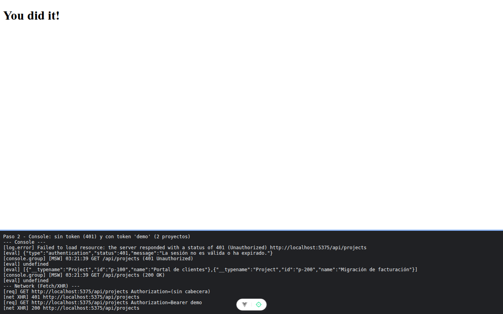

# Paso 2. Un solo formato de error y el cliente REST

<!-- lang: es-CO -->

Práctica 5.4, ProjectHub con clientes REST (Axios) y GraphQL (Apollo Client) sobre un servidor simulado con MSW.

## Qué cambió en este paso

Nuevos: `src/services/appError.js` (clase `AppError` y los traductores `normalizeRestError` y `normalizeGraphqlError`) y `src/services/restClient.js` (instancia de Axios con dos interceptores).

## Concepto

`AppError` es la forma única de todo fallo: la vista decide con `error.type`, nunca con el texto. El interceptor de petición agrega `Authorization: Bearer <token>` desde `localStorage`; el de respuesta traduce cualquier fallo de Axios a `AppError`. Es el único archivo que conoce Axios.

## Cómo ejecutar

```bash
npm install              # instala las dependencias (una vez por carpeta)
npx vite --port 5175     # como en la guía; también sirve npm run dev (puerto 5173)
```

Abre la dirección que muestra la terminal (`http://localhost:5175/`).

## Qué debes ver

Según la guía: `{type: 'authentication', status: 401, message: 'La sesión no es válida o ha expirado.'}`. Con `localStorage.setItem('access_token', 'demo')` y la segunda línea otra vez llega un arreglo con los 2 proyectos.

## Captura



En la consola, el objeto con `type: "authentication"` y `status: 401`; luego, con el token `demo`, los 2 proyectos. En la red, la primera petición va sin cabecera (401) y la segunda con `Authorization=Bearer demo` (200). Como anuncia la guía, la primera importación hizo que Vite preparara Axios y recargara la página; la captura es la segunda pasada.

La franja oscura de abajo reproduce lo que muestran la consola, la red de `F12` o la terminal; se tomó con el servidor en el puerto 5375, por eso la dirección no dice 5175.
