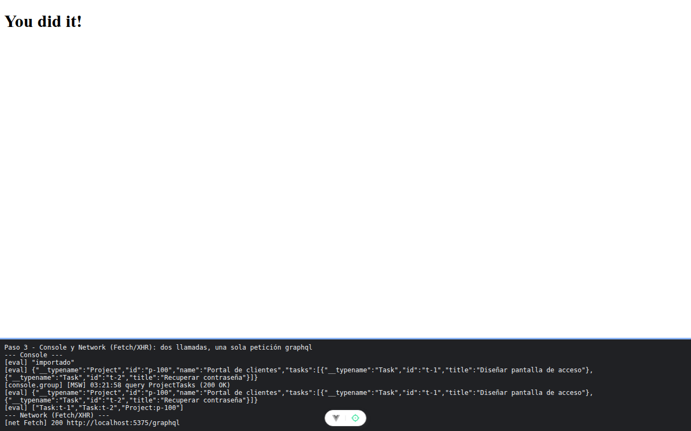

# Paso 3. GraphQL con Apollo y su caché

<!-- lang: es-CO -->

Práctica 5.4, ProjectHub con clientes REST (Axios) y GraphQL (Apollo Client) sobre un servidor simulado con MSW.

## Qué cambió en este paso

Nuevo: `src/services/graphqlClient.js` (cliente de Apollo con `HttpLink` e `InMemoryCache`, la consulta `ProjectTasks` y `cacheKeys()`).

## Concepto

En GraphQL el cliente pide exactamente los campos que quiere en un solo viaje. `InMemoryCache` normaliza: guarda cada objeto una vez con la clave `__typename:id`. Con `fetchPolicy: 'cache-first'` la segunda consulta igual sale de la caché, sin red; `network-only` obliga a ir al servidor.

## Cómo ejecutar

```bash
npm install              # instala las dependencias (una vez por carpeta)
npx vite --port 5175     # como en la guía; también sirve npm run dev (puerto 5173)
```

Abre la dirección que muestra la terminal (`http://localhost:5175/`).

## Qué debes ver

Según la guía: las dos llamadas devuelven `Portal de clientes` con sus 2 tareas, pero en **Network** (**Fetch/XHR**) hay **una sola** petición `graphql`. `cacheKeys()` muestra `['Task:t-1', 'Task:t-2', 'Project:p-100']`.

## Captura



Dos llamadas a `getProjectTasks('p-100')` con la misma respuesta, una sola petición `graphql` en la red y `["Task:t-1","Task:t-2","Project:p-100"]`.

La franja oscura de abajo reproduce lo que muestran la consola, la red de `F12` o la terminal; se tomó con el servidor en el puerto 5375, por eso la dirección no dice 5175.
