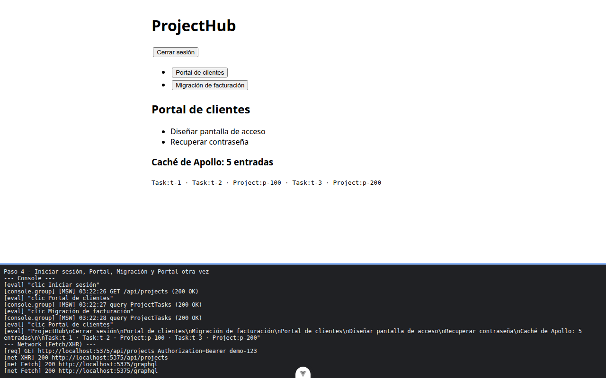
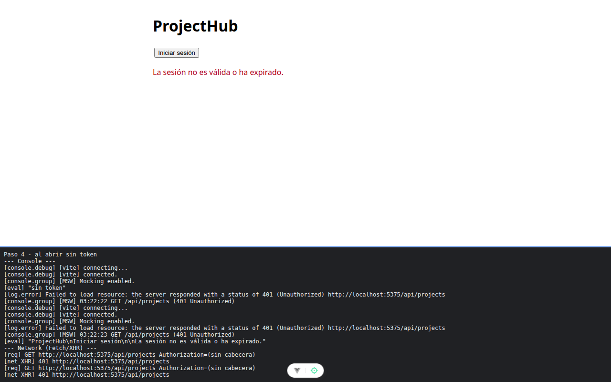

# Paso 4. La tienda y la pantalla

<!-- lang: es-CO -->

Práctica 5.4, ProjectHub con clientes REST (Axios) y GraphQL (Apollo Client) sobre un servidor simulado con MSW.

## Qué cambió en este paso

Nuevos: `src/stores/projects.js` (tienda de Pinia) y `src/components/ProjectDetail.vue`. Reemplazado: `src/App.vue` (pantalla de ProjectHub).

## Concepto

Capas: componente, tienda, servicio, red. La pantalla solo lee la tienda y llama a sus acciones; la tienda llama a los servicios y decide con `error.type` (el 422 no va al aviso general). `onMounted` pide la lista al aparecer y `v-if`/`v-else` muestran un solo botón según haya sesión.

## Cómo ejecutar

```bash
npm install              # instala las dependencias (una vez por carpeta)
npx vite --port 5175     # como en la guía; también sirve npm run dev (puerto 5173)
```

Abre la dirección que muestra la terminal (`http://localhost:5175/`).

## Qué debes ver

Según la guía: en rojo, `La sesión no es válida o ha expirado.` Al pulsar **Iniciar sesión** salen los 2 proyectos y la petición `projects` lleva `Authorization: Bearer demo-123`. Tras abrir Portal, Migración y Portal otra vez: solo **2** peticiones `graphql` y `Caché de Apollo: 5 entradas`, con `Project:p-100` una sola vez.

## Captura



Sesión iniciada y Portal de clientes abierto por segunda vez: `Caché de Apollo: 5 entradas` sin claves repetidas; en la red, `projects` con `Bearer demo-123` y solo 2 peticiones `graphql`.



Al abrir sin token: el aviso rojo `La sesión no es válida o ha expirado.` y el `Failed to load resource ... 401 (Unauthorized)` de Chrome.

La franja oscura de abajo reproduce lo que muestran la consola, la red de `F12` o la terminal; se tomó con el servidor en el puerto 5375, por eso la dirección no dice 5175.
