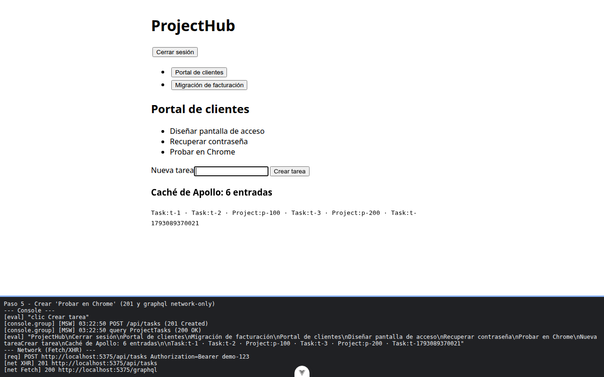
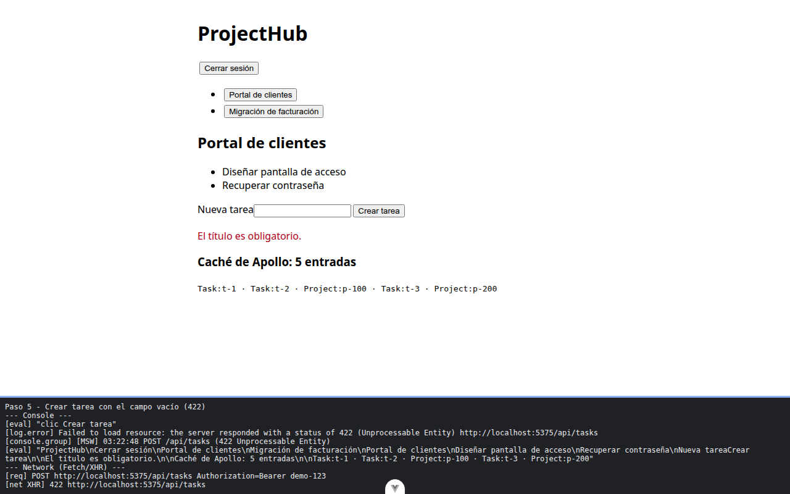
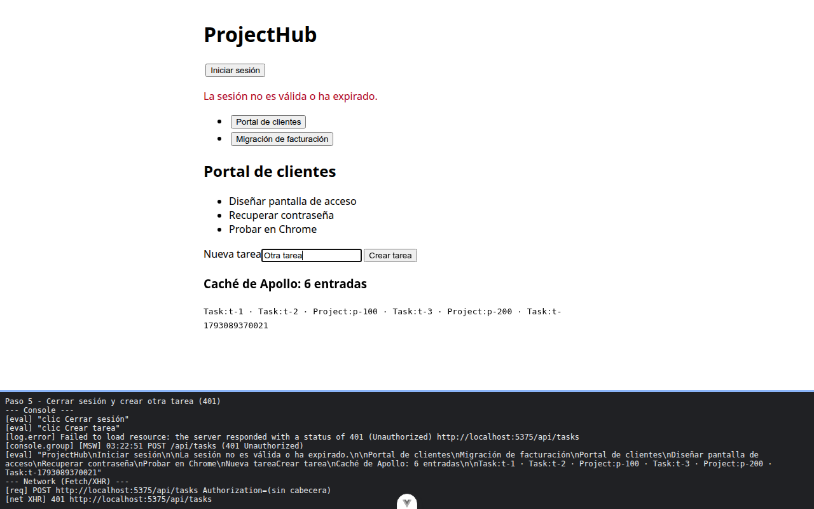

# Paso 5. Crear tareas: el 422 junto al campo y el 401 como aviso

<!-- lang: es-CO -->

Práctica 5.4, ProjectHub con clientes REST (Axios) y GraphQL (Apollo Client) sobre un servidor simulado con MSW.

## Qué cambió en este paso

Nuevo: `src/components/TaskForm.vue`. Cambiado: `src/components/ProjectDetail.vue` (importa `TaskForm` y lo pone después de `</ul>`).

## Concepto

El mismo `AppError` llega con dos `type` distintos y cada uno se muestra en su sitio: `validation` (422) debajo del campo, `authentication` (401) arriba como aviso. `v-model` une el campo con la `ref`, `@submit.prevent` evita la recarga y, al crear, `addTask` pide el proyecto con `network-only` porque la caché quedó vieja.

## Cómo ejecutar

```bash
npm install              # instala las dependencias (una vez por carpeta)
npx vite --port 5175     # como en la guía; también sirve npm run dev (puerto 5173)
```

Abre la dirección que muestra la terminal (`http://localhost:5175/`).

## Qué debes ver

Según la guía: campo vacío: `El título es obligatorio.` debajo del campo y `tasks` con **422**. `Probar en Chrome`: aparece en la lista, `tasks` responde **201**, sale una petición `graphql` nueva y el panel pasa a 6 entradas. Tras **Cerrar sesión** y crear otra: arriba `La sesión no es válida o ha expirado.` y `tasks` con **401**.

## Captura



Tarea `Probar en Chrome` creada: `tasks` 201, una petición `graphql` nueva y `Caché de Apollo: 6 entradas`.



Campo vacío: `El título es obligatorio.` debajo del campo y `tasks` con 422.



Después de Cerrar sesión: aviso rojo arriba, `tasks` con 401 sin cabecera y la lista sigue en pantalla.

La franja oscura de abajo reproduce lo que muestran la consola, la red de `F12` o la terminal; se tomó con el servidor en el puerto 5375, por eso la dirección no dice 5175.
