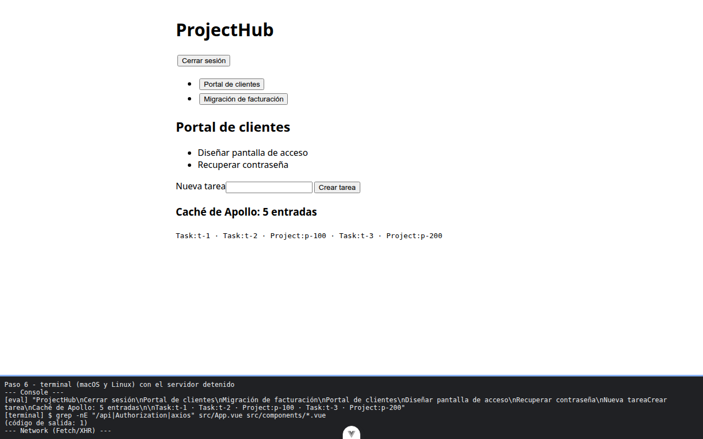

# Paso 6. Comprobar la separación y limpiar

<!-- lang: es-CO -->

Práctica 5.4, ProjectHub con clientes REST (Axios) y GraphQL (Apollo Client) sobre un servidor simulado con MSW.

## Qué cambió en este paso

Sin cambios de código: es igual en código a `ejercicio-resuelto/` del repositorio (más comentarios).

## Concepto

La separación por capas se puede comprobar con una búsqueda: ningún componente contiene direcciones (`/api`), cabeceras (`Authorization`) ni `axios`. Las direcciones viven en `.env`, las cabeceras en `restClient.js` y la pantalla solo habla con la tienda.

## Cómo ejecutar

```bash
npm install              # instala las dependencias (una vez por carpeta)
npx vite --port 5175     # como en la guía; también sirve npm run dev (puerto 5173)
```

Abre la dirección que muestra la terminal (`http://localhost:5175/`).

## Qué debes ver

Según la guía: ninguna línea en la salida de `grep -nE "/api|Authorization|axios" src/App.vue src/components/*.vue` (en PowerShell, `Select-String` tampoco muestra nada).

## Captura



Aplicación terminada (sesión iniciada, Portal de clientes, `Caché de Apollo: 5 entradas`) y, en la franja, el `grep` sin ninguna línea (código de salida 1).

La franja oscura de abajo reproduce lo que muestran la consola, la red de `F12` o la terminal; se tomó con el servidor en el puerto 5375, por eso la dirección no dice 5175.
