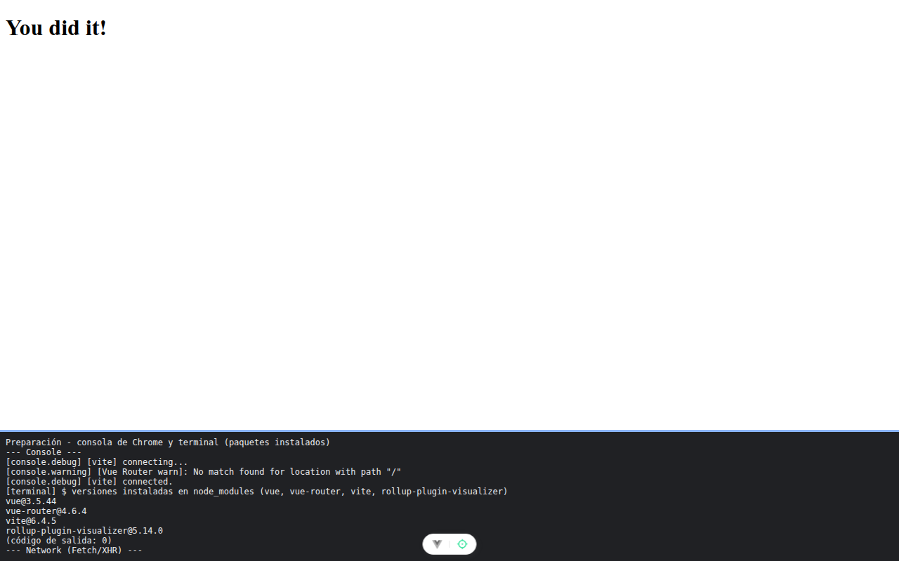

# Paso 0. Preparación

<!-- lang: es-CO -->

Práctica 6.4, Catálogo Pro: una SPA con 2.000 productos que se mide, se optimiza y se vuelve a medir.

## Qué cambió en este paso

Proyecto creado con `npx --yes create-vue@3.16.4 catalogo-pro --bare --router` más `npm install -D rollup-plugin-visualizer@5.14.0`. En `index.html`, `lang="es"` y el título `Catálogo Pro`. Solo se agregaron comentarios a `src/main.js`, `src/App.vue`, `src/router/index.js` y `vite.config.js`.

## Concepto

`--router` instala Vue Router y lo conecta en `main.js` con `app.use(router)`; `--bare` deja el proyecto sin páginas de ejemplo. `rollup-plugin-visualizer` es la herramienta que en el paso 3 dibuja el mapa del paquete.

## Cómo ejecutar

```bash
npm install              # instala las dependencias (una vez por carpeta)
npm run dev              # servidor de desarrollo en http://localhost:5173
```

## Qué debes ver

Según la guía: la terminal termina sin errores (`added ... packages`). Puede salir un aviso amarillo `npm warn`: no impide seguir.

## Captura



"You did it!" y, en la franja, las versiones instaladas (incluida `rollup-plugin-visualizer@5.14.0`). La consola avisa `[Vue Router warn]: No match found for location with path "/"`: es normal, la tabla de rutas todavía está vacía.

La franja oscura de abajo reproduce lo que muestran la consola, la red de `F12` o la terminal; se tomó con el servidor en otro puerto (5376 o 4376), por eso la dirección no dice 5173 ni 4173.
