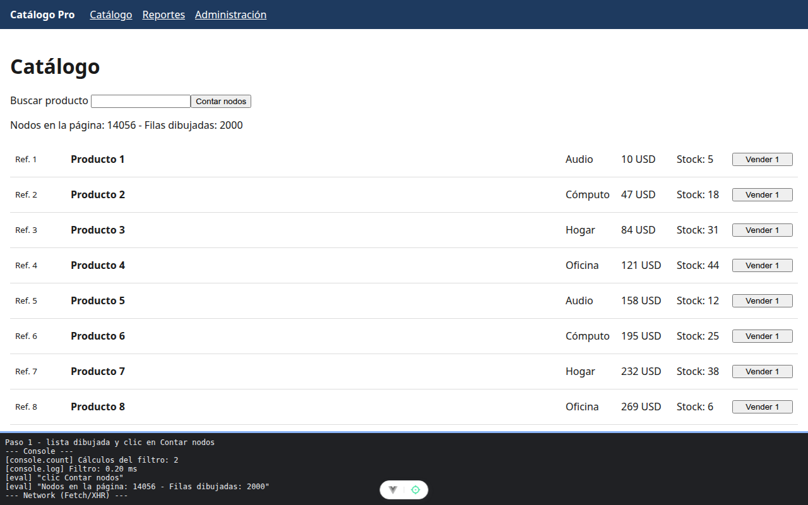

# Paso 1. Construir la SPA de partida

<!-- lang: es-CO -->

Práctica 6.4, Catálogo Pro: una SPA con 2.000 productos que se mide, se optimiza y se vuelve a medir.

## Qué cambió en este paso

Nuevos: `src/datos/productos.js`, `src/components/FilaProducto.vue`, `src/views/CatalogoView.vue`, `src/views/ReportesView.vue` y `src/views/AdminView.vue`. Reemplazados: `src/router/index.js` (3 rutas con import estático) y `src/App.vue` (encabezado, menú y `<RouterView />`).

## Concepto

Es la línea base: dibuja las 2.000 filas y carga todas las vistas de entrada. `filtrar()` es una función llamada desde la plantilla, así que Vue la vuelve a ejecutar en cada dibujo; `console.count` y `performance.mark`/`measure` lo dejan a la vista. `shallowRef` guarda la lista grande sin volver reactivo cada producto, y la fila avisa `vender` con `emit` para que el padre cambie el stock.

## Cómo ejecutar

```bash
npm install              # instala las dependencias (una vez por carpeta)
npm run dev              # servidor de desarrollo en http://localhost:5173
```

## Qué debes ver

Según la guía: "Nodos en la página: **más de 14.000** - Filas dibujadas: **2000**", y en la consola `Cálculos del filtro: 2` con una línea `Filtro: ... ms`. Los enlaces Reportes y Administración también funcionan.

## Captura



Tras pulsar Contar nodos: "Nodos en la página: 14056 - Filas dibujadas: 2000" y `Cálculos del filtro: 2`. Comprobados también los enlaces Reportes y Administración.

La franja oscura de abajo reproduce lo que muestran la consola, la red de `F12` o la terminal; se tomó con el servidor en otro puerto (5376 o 4376), por eso la dirección no dice 5173 ni 4173.
