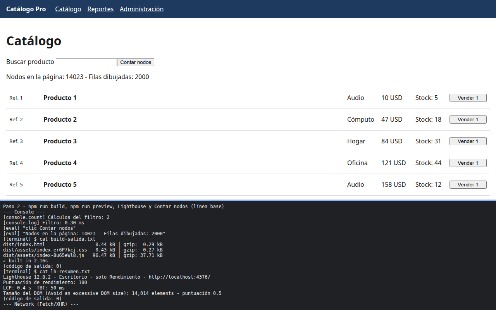

# Paso 2. Medir la línea base

<!-- lang: es-CO -->

Práctica 6.4, Catálogo Pro: una SPA con 2.000 productos que se mide, se optimiza y se vuelve a medir.

## Qué cambió en este paso

Nuevo: `docs/performance-report.md`, con la columna **Antes** llena con lo medido en el equipo de prueba. Sin cambios de código.

## Concepto

Se mide la compilación de producción (`npm run build` y `npm run preview`), no el servidor de desarrollo. Lighthouse da la puntuación, LCP (cuándo aparece lo principal), TBT (tiempo bloqueado) y el tamaño del DOM; la pestaña Performance muestra las barras `filtro` de tus `performance.measure`.

## Cómo ejecutar

```bash
npm install              # instala las dependencias (una vez por carpeta)
npm run build            # compila a dist/
npm run preview          # sirve la compilación en http://localhost:4173
```

## Qué debes ver

Según la guía: en `dist/assets` **un solo** archivo `index-....js` de unos 96 kB (unos 38 kB gzip), más un `index-....css` pequeño. En Lighthouse aparece el aviso de tamaño del DOM con unos 14.000 elementos.

## Captura



Compilación con un solo `index-Bu65eWl8.js` de 96,47 kB (37,71 kB gzip), Lighthouse de escritorio con puntuación 100, LCP 0,4 s, TBT 50 ms y "Avoid an excessive DOM size" con 14.014 elementos; Contar nodos da 14.023 nodos y 2000 filas. Al escribir `19` el filtro midió 0,20 ms.

La franja oscura de abajo reproduce lo que muestran la consola, la red de `F12` o la terminal; se tomó con el servidor en otro puerto (5376 o 4376), por eso la dirección no dice 5173 ni 4173.
