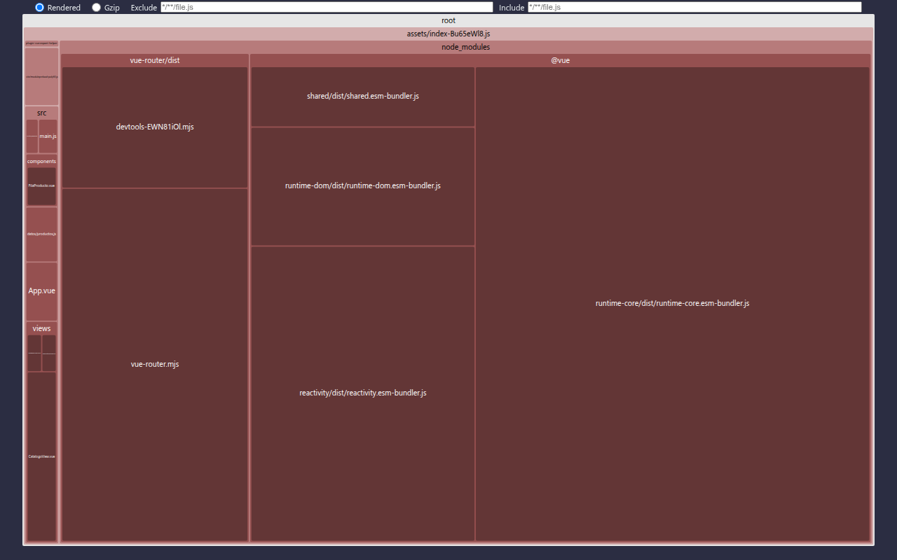

# Paso 3. Ver el mapa del paquete

<!-- lang: es-CO -->

Práctica 6.4, Catálogo Pro: una SPA con 2.000 productos que se mide, se optimiza y se vuelve a medir.

## Qué cambió en este paso

Reemplazado: `vite.config.js` (agrega `rollup-plugin-visualizer` solo con `--mode analisis`). Cambiado: `package.json` (script `build:analisis`).

## Concepto

`defineConfig` recibe una función con `{ mode }`; el visualizador solo entra cuando `mode` vale `analisis`, para no alargar cada compilación. El mapa dibuja cada módulo como un rectángulo cuya área es su peso.

## Cómo ejecutar

```bash
npm install              # instala las dependencias (una vez por carpeta)
npm run build:analisis   # compila y genera estadisticas.html en la carpeta del proyecto
```

Abre `estadisticas.html` en Chrome (arrástralo a una pestaña). Para ver la aplicación, `npm run dev`.

## Qué debes ver

Según la guía: un rectángulo grande con `@vue` (el núcleo de Vue) y `vue-router` dentro de `node_modules`, y uno pequeño con tus archivos de `src`. Vue pesa más que todo tu código junto.

## Captura



`estadisticas.html` abierto en Chrome: `node_modules` con `vue-router/dist` y `@vue` ocupa casi todo `assets/index-*.js`; `src` es la franja angosta de la izquierda.
