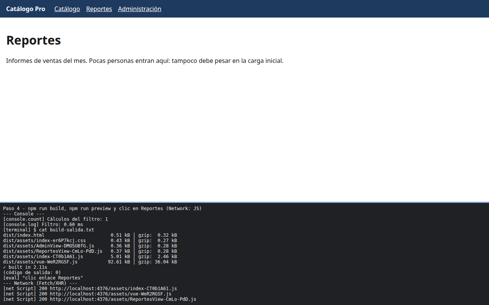

# Paso 4. Rutas diferidas y manualChunks

<!-- lang: es-CO -->

Práctica 6.4, Catálogo Pro: una SPA con 2.000 productos que se mide, se optimiza y se vuelve a medir.

## Qué cambió en este paso

Cambiados: `src/router/index.js` (Reportes y Administración con `() => import(...)`) y `vite.config.js` (constante `VUE` y bloque `build.rollupOptions.output.manualChunks`).

## Concepto

Una ruta con `import()` dinámico sale del paquete inicial a su propio fragmento, que el navegador descarga solo al visitarla. `manualChunks` pone Vue y Vue Router en `vue-*.js`: cambian poco, así que el navegador los conserva en caché entre publicaciones.

## Cómo ejecutar

```bash
npm install              # instala las dependencias (una vez por carpeta)
npm run build            # compila a dist/
npm run preview          # sirve la compilación en http://localhost:4173
```

## Qué debes ver

Según la guía: cuatro archivos: `vue-....js` (unos 93 kB), `index-....js` (unos 5 kB), `ReportesView-....js` y `AdminView-....js` (menos de 1 kB cada uno), además de `index-....css`. Con `npm run preview`, `ReportesView-....js` se descarga solo al entrar a Reportes.

## Captura



Compilación con `vue-*.js` 92,61 kB, `index-*.js` 5,01 kB y las dos vistas de 0,36 y 0,37 kB. En la red, al abrir solo bajan `index` y `vue`; `ReportesView-*.js` aparece después del clic en Reportes.

La franja oscura de abajo reproduce lo que muestran la consola, la red de `F12` o la terminal; se tomó con el servidor en otro puerto (5376 o 4376), por eso la dirección no dice 5173 ni 4173.
