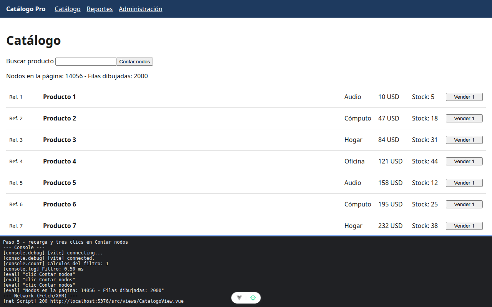

# Paso 5. Memoizar el filtro con computed

<!-- lang: es-CO -->

Práctica 6.4, Catálogo Pro: una SPA con 2.000 productos que se mide, se optimiza y se vuelve a medir.

## Qué cambió en este paso

Cambiado: `src/views/CatalogoView.vue` (`computed` en el import, `function filtrar()` pasa a `const filtrados = computed(...)` y la plantilla usa `filtrados` sin paréntesis).

## Concepto

`computed` memoiza: guarda el resultado y solo recalcula cuando cambia algo que leyó (`busqueda` o `productos`). Redibujar la vista por otro motivo, como Contar nodos, ya no repite el filtro. Un `computed` se lee como un dato, sin paréntesis.

## Cómo ejecutar

```bash
npm install              # instala las dependencias (una vez por carpeta)
npm run dev              # servidor de desarrollo en http://localhost:5173
```

## Qué debes ver

Según la guía: la consola se queda en `Cálculos del filtro: 1`. Si escribes en el buscador, suma uno por tecla. Las filas dibujadas siguen en 2000.

## Captura



Tres clics en Contar nodos y la consola sigue en `Cálculos del filtro: 1`; aún 2000 filas. Al escribir `1` y `9` en el buscador subió a 2 y 3.

La franja oscura de abajo reproduce lo que muestran la consola, la red de `F12` o la terminal; se tomó con el servidor en otro puerto (5376 o 4376), por eso la dirección no dice 5173 ni 4173.
