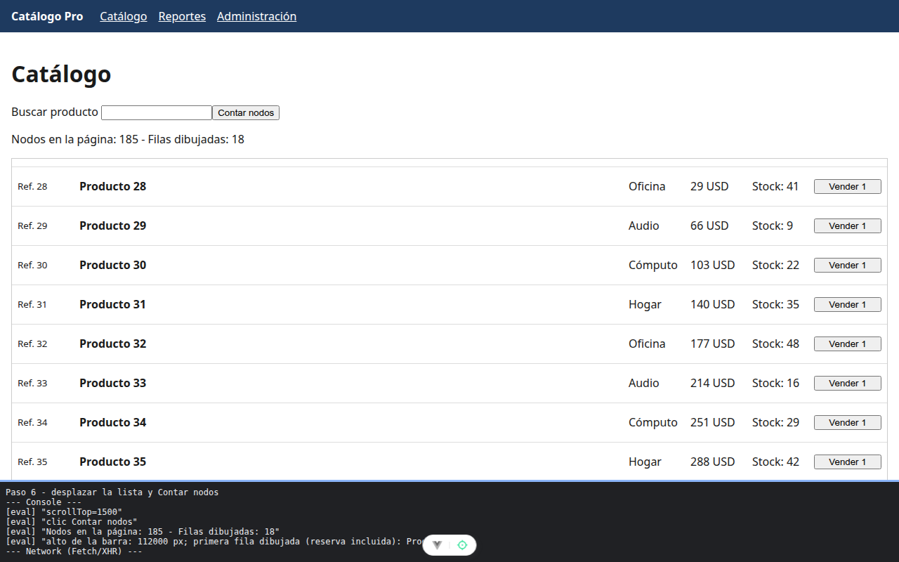

# Paso 6. Dibujar solo lo que se ve: lista virtual

<!-- lang: es-CO -->

Práctica 6.4, Catálogo Pro: una SPA con 2.000 productos que se mide, se optimiza y se vuelve a medir.

## Qué cambió en este paso

Nuevo: `src/components/ListaVirtual.vue`. Cambiado: `src/views/CatalogoView.vue` (importa `ListaVirtual` en lugar de `FilaProducto` y la usa en lugar del `<section>`).

## Concepto

Lista virtual: de 2.000 productos solo se dibujan las 10 filas que caben en la caja de 560 px más 4 de reserva arriba y 4 abajo. Un relleno con el alto de todas las filas mantiene la barra del tamaño real y `translateY` baja las 18 filas a su lugar. Todo se calcula con `computed` a partir de `scrollTop`.

## Cómo ejecutar

```bash
npm install              # instala las dependencias (una vez por carpeta)
npm run dev              # servidor de desarrollo en http://localhost:5173
```

## Qué debes ver

Según la guía: "Filas dibujadas: **18**" y menos de 200 nodos. La barra de desplazamiento sigue teniendo el tamaño de 2.000 productos.

## Captura



Tras bajar 1500 px: "Nodos en la página: 185 - Filas dibujadas: 18"; la barra mide 112.000 px (2.000 × 56).

La franja oscura de abajo reproduce lo que muestran la consola, la red de `F12` o la terminal; se tomó con el servidor en otro puerto (5376 o 4376), por eso la dirección no dice 5173 ni 4173.
