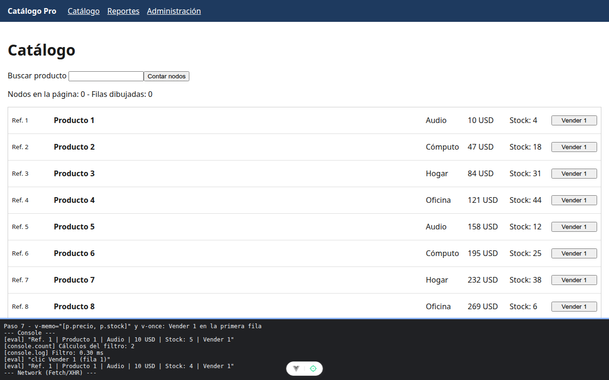

# Paso 7. Pistas de dibujo: v-memo y v-once

<!-- lang: es-CO -->

Práctica 6.4, Catálogo Pro: una SPA con 2.000 productos que se mide, se optimiza y se vuelve a medir.

## Qué cambió en este paso

Cambiados: `src/components/ListaVirtual.vue` (`v-memo="[p.precio, p.stock]"` en cada fila) y `src/components/FilaProducto.vue` (`v-once` en la referencia).

## Concepto

`v-memo` es una promesa a Vue: la fila solo se redibuja si cambian los valores de la lista. Si la lista olvida un dato que se muestra, la pantalla queda vieja. `v-once` dibuja una vez y no vuelve a revisar: sirve para lo que nunca cambia, como el id.

## Cómo ejecutar

```bash
npm install              # instala las dependencias (una vez por carpeta)
npm run dev              # servidor de desarrollo en http://localhost:5173
```

## Qué debes ver

Según la guía: con `v-memo="[p.precio]"` el stock no baja al pulsar **Vender 1**. Con `v-memo="[p.precio, p.stock]"` el stock baja en uno y la referencia sigue igual.

## Captura



Código final del paso: Vender 1 en Producto 1 baja el stock de 5 a 4.


Predicción del paso, con `v-memo="[p.precio]"` en una copia temporal (no es el código de esta carpeta): tras Vender 1 la fila sigue en `Stock: 5`.

La franja oscura de abajo reproduce lo que muestran la consola, la red de `F12` o la terminal; se tomó con el servidor en otro puerto (5376 o 4376), por eso la dirección no dice 5173 ni 4173.
