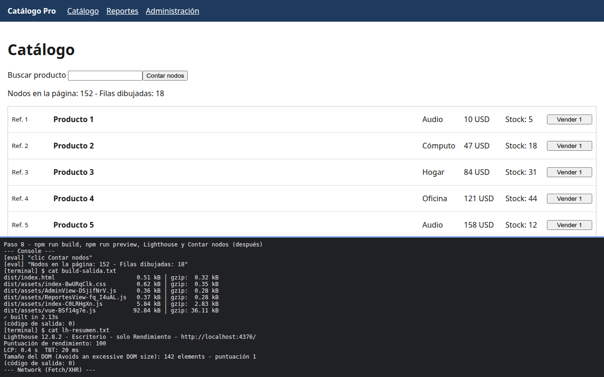

# Paso 8. Medir otra vez y cerrar el informe

<!-- lang: es-CO -->

Práctica 6.4, Catálogo Pro: una SPA con 2.000 productos que se mide, se optimiza y se vuelve a medir.

## Qué cambió en este paso

Cambiado: `docs/performance-report.md` (columna **Después**, cambios aplicados y conclusión). Sin cambios de código: es igual en código a `ejercicio-resuelto/` del repositorio (más comentarios).

## Concepto

La comparación solo vale en las mismas condiciones del paso 2: compilación de producción, Lighthouse de escritorio y el mismo botón Contar nodos.

## Cómo ejecutar

```bash
npm install              # instala las dependencias (una vez por carpeta)
npm run build            # compila a dist/
npm run preview          # sirve la compilación en http://localhost:4173
```

## Qué debes ver

Según la guía: menos JavaScript propio en la carga inicial (unos 6 kB en lugar de 96 kB en un solo archivo), unos 150 nodos en lugar de más de 14.000, 18 filas en lugar de 2.000, TBT más bajo y el aviso de DOM excesivo fuera de Lighthouse.

## Captura



Compilación con `index-*.js` 5,84 kB y `vue-*.js` 92,84 kB; Lighthouse 100, LCP 0,4 s, TBT 20 ms y DOM de 142 elementos (auditoría aprobada); Contar nodos da 152 nodos y 18 filas.

La franja oscura de abajo reproduce lo que muestran la consola, la red de `F12` o la terminal; se tomó con el servidor en otro puerto (5376 o 4376), por eso la dirección no dice 5173 ni 4173.
