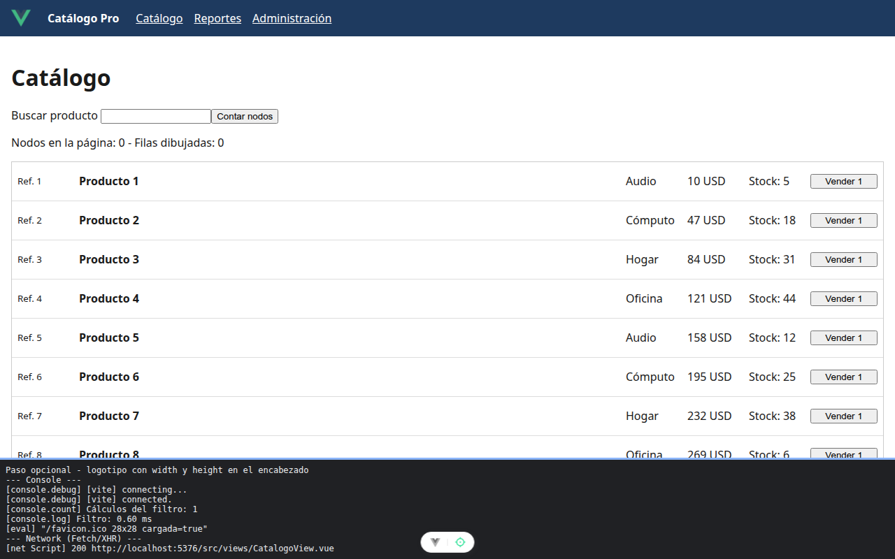

# Paso opcional. Imágenes con tamaño declarado

<!-- lang: es-CO -->

Práctica 6.4, Catálogo Pro: una SPA con 2.000 productos que se mide, se optimiza y se vuelve a medir.

## Qué cambió en este paso

Cambiado: `src/App.vue` (logotipo `/favicon.ico` con `width="28"` y `height="28"` antes del nombre). No forma parte de `ejercicio-resuelto/`.

## Concepto

`width` y `height` reservan el espacio de la imagen antes de que llegue, así la página no salta. `alt=""` la marca como decorativa. No lleva `loading="lazy"`: está arriba y se ve al entrar.

## Cómo ejecutar

```bash
npm install              # instala las dependencias (una vez por carpeta)
npm run dev              # servidor de desarrollo en http://localhost:5173
```

## Qué debes ver

Según la guía: el logotipo de Vue a la izquierda de "Catálogo Pro" en el encabezado.

## Captura



Logotipo de Vue de 28 × 28 px en el encabezado, cargado.

La franja oscura de abajo reproduce lo que muestran la consola, la red de `F12` o la terminal; se tomó con el servidor en otro puerto (5376 o 4376), por eso la dirección no dice 5173 ni 4173.
